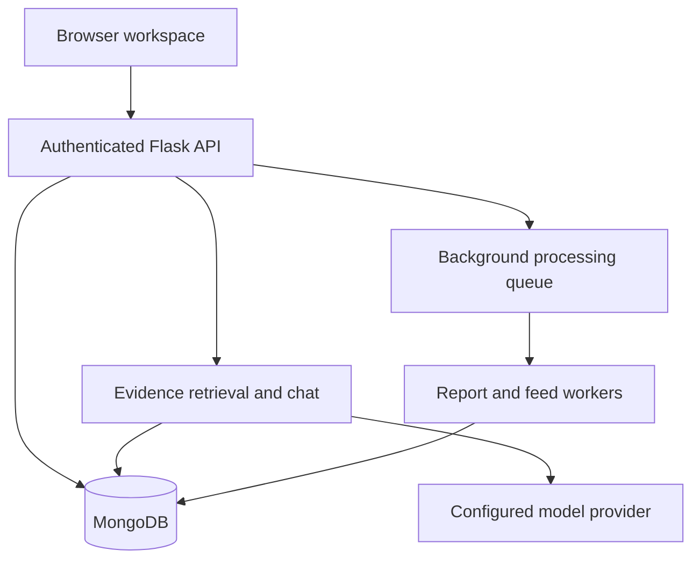

# Signal Desk

**A threat intelligence workspace with source-backed investigation, AI-assisted analysis, and MongoDB database experiments.**

Signal Desk brings public threat reports, indicators, analyst notes, and an evidence-grounded chatbot into a blue-and-white browser workspace. Every report retains its source. AI answers use imported evidence, and database experiments keep measured results separate from conceptual explanations.

[Open the website](https://signal-desk-xi-seven.vercel.app/) · [Documentation](docs/README.md) · [Architecture](docs/ARCHITECTURE.md) · [Setup](docs/GETTING_STARTED.md) · [Troubleshooting](docs/OPERATIONS.md)

> The hosted workspace requires the owner's application login. A deployed website or a saved API key does not prove that a model can generate answers. Provider access, quotas, and live completion must be verified separately.

## Explore the workspace

| Area | What you can do |
| --- | --- |
| **AI Chatbot** | Import public evidence, ask questions with citations, filter by platform/threat stage, and resume completed conversations |
| **Threat explorer** | Search public feed events, inspect provenance and reported indicators, and export records |
| **Shared indicators** | Explore recurring observables across source events without treating overlap as proof of an attack |
| **File & message checks** | Inspect file hashes/signatures locally in the browser and compare message cues with stored indicators |
| **Investigation notebook** | Record case notes, status, and analyst decisions |
| **Database experiments** | Explore chapters 11–18 and import measured JSON evidence from separate Docker experiments |
| **Compare databases** | Review MongoDB, Cassandra, and Neo4j tradeoffs; measured results remain explicitly labelled |
| **Legacy laboratory** | Access PDF report processing, schema analysis, and chapter 8/9 evidence tools at `/laboratory` |

### Evidence-grounded chat

The **Evidence library appears above the chat**. Search and page through feed reports, select up to five per import, paste an advisory, or load a `.txt`/`.md` excerpt with its original HTTPS source URL. An uploaded excerpt is limited to 20,000 characters; text files are limited to 80 KB. PDFs are handled by the separate report-processing workflow, not this text uploader.

The server creates real embeddings, stores them in MongoDB, retrieves up to three matching passages, and supplies the last five completed exchanges to the model. Sources and analyst assessments remain visible. Incomplete answers are marked and are not stored as completed conversations.

| Provider | Chat integration | Embeddings | Deployment |
| --- | --- | --- | --- |
| **Gemini** | Native `generateContent` API | Google OpenAI-compatible embeddings API | Online on Vercel |
| **OpenAI** | Chat Completions API | OpenAI embeddings API | Optional hosted provider; API credits required |
| **Ollama** | Local chat API | Local embedding model | Bundled local Docker stack |

The current hosted configuration targets `gemini-3.1-flash-lite` with `gemini-embedding-001` (3072 dimensions). Provider model names and quotas can change. Consult [Google's pricing](https://ai.google.dev/gemini-api/docs/pricing) and your API project's limits. Keep billing disabled if using only the free tier. There is **no automatic paid-provider fallback**. Free-tier Google content may be used to improve its products; use public evidence only.

## Architecture



The browser never receives provider API keys. The hosted app uses a shared application account with signed session cookies, not separate tenant identities. Local database experiments do not reconfigure the production database. Read the [architecture and storage guide](docs/ARCHITECTURE.md).

## Run the project

### Option 1 — use the hosted workspace

Open [Signal Desk](https://signal-desk-xi-seven.vercel.app/), sign in, and select **AI Chatbot**. Add a public source to the Evidence library, keep both filters on **All**, and ask a specific question about that source. Imported feed metadata provides limited context; add a fuller advisory excerpt for a deeper answer.

### Option 2 — complete local Docker stack

Requires Git, running Docker Desktop with Linux containers, and enough RAM/disk space for MongoDB and downloaded models.

```powershell
git clone https://github.com/SOLANKYYY/signal-desk.git
cd signal-desk
powershell -NoProfile -ExecutionPolicy Bypass -File .\appendix-a\START.ps1
```

Open **http://localhost:8019/#assistant**. The username is `admin`; the script generates a password in the ignored `appendix-a/.env`. This starts the integrated UI, MongoDB, and Ollama. The first model downloads may take time and several GB of storage. No hosted model key is needed.

### Option 3 — Python development

Use Python **3.12** for parity with deployment. The root Compose file starts **MongoDB only**.

```powershell
git clone https://github.com/SOLANKYYY/signal-desk.git
cd signal-desk
py -3.12 -m venv .venv
.\.venv\Scripts\python.exe -m pip install -r requirements-dev.txt
docker compose up -d
$env:MONGODB_URI = "mongodb://127.0.0.1:27017"
$env:MONGODB_DB = "signal_desk_dev"
$env:APP_USERNAME = "admin"
# Set APP_PASSWORD privately in this shell (at least 16 characters).
.\.venv\Scripts\python.exe -m flask --app app run --host 127.0.0.1 --port 8000
```

Open **http://localhost:8000**. Configure a model separately to use chat. For the older standalone report server, run `python -m backend.server`; it is a distinct local entrypoint. See [full setup and environment configuration](docs/GETTING_STARTED.md).

## Configuration

`.env.example` documents the settings but contains no working credentials. The Python app does **not** automatically load `.env` files; use shell variables or Vercel environment settings. Docker Compose uses its own `.env` handling.

| Setting | Purpose |
| --- | --- |
| `MONGODB_URI`, `MONGODB_DB` | Database connection and database name |
| `APP_USERNAME`, `APP_PASSWORD` | Shared hosted app login; password minimum 16 characters |
| `CRON_SECRET` | Scheduled task authentication; minimum 32 characters |
| `LLM_BACKEND` | `gemini`, `openai`, or `ollama` |
| `GEMINI_API_KEY`, `GEMINI_MODEL` | Gemini server credential and chat model |
| `OPENAI_API_KEY`, `OPENAI_MODEL` | Optional OpenAI configuration |
| `EMBEDDING_MODEL`, `EMBEDDING_DIMENSIONS` | Must match the selected provider's embeddings |
| `CHAT_RETRIEVAL` | `exact` or `atlas`; Atlas requires a compatible vector index |

Changing the embedding provider/model/dimensions requires re-importing evidence. Changing only the chat model does not. Exact mode ranks at most 3,000 matching chunks in Python; it is not Atlas indexed Vector Search.

## Repository map

| Path | Responsibility |
| --- | --- |
| `frontend/` | Source HTML, CSS, and browser JavaScript |
| `backend/` | Authentication, APIs, intelligence, evidence, chat, investigations, and lab imports |
| `app.py` / `worker.py` | Hosted web entrypoint / queue worker |
| `appendix-a/` | Local integrated AI stack, PowerShell launcher, Dockerfile, vector-index example |
| `labs/chapter08/`, `labs/chapter09/` | Earlier standalone database lab kits |
| `data/` | Bundled data and provenance; not private database exports |
| `docs/` | Documentation index, setup, architecture, operations, and coursework guides |
| `scripts/` | Static build and opt-in provider inventory helpers |
| `tools/`, `mongodb/` | Data preparation and database utilities |
| `tests/` | Python and JavaScript regression tests |
| `.github/` | Contribution templates |
| `results/`, `validation-results/` | Local output / historical validation assets; not proof of current production health |
| `public/` | Generated static assets; ignored by Git, never edit as source |

Chapters 11–18 are integrated through the coursework hub; their separate submission kits are not all stored in this repository. See [coursework evidence semantics](docs/COURSEWORK_HUB.md).

## Verification

```powershell
.\.venv\Scripts\python.exe -m unittest discover -s tests -v
node tests/test_assistant_ui.cjs
```

Node is only needed for the JavaScript test, not for building the frontend. Tests cover isolated application behavior with mock providers/databases. They do not certify live API credits, Atlas networking, Docker performance, or an end-to-end AI answer. Use the [live verification checklist](docs/OPERATIONS.md) before a demonstration.

## Data, security, and limitations

- Bundled public feed data distinguishes **indicator observations** from **events** and **incidents**. The 15,000-observation snapshot does not represent 15,000 confirmed attacks.
- Report titles and dates do not establish that a device is infected or a threat is resolved. Imported feed records default to unknown platform and unassessed stage.
- Ratings are rule-based review aids, not CVSS scores, malware verdicts, or guarantees of safety.
- The assistant cannot scan or modify your device. It does not execute instructions found in source text.
- Files are not uploaded for malware execution. Optional VirusTotal lookup uses hashes, not submitted files.
- Never commit keys, `.env` files, passwords, private incident data, or TLS private keys. See [Security](SECURITY.md) and [data provenance](data/PROVENANCE.md).

## Documentation and contributing

Start with the [documentation index](docs/README.md). For changes, read [Contributing](CONTRIBUTING.md), use a focused branch, and include relevant verification in your pull request.

Maintained by [SOLANKYYY](https://github.com/SOLANKYYY). Coursework references and submission requirements are recorded in [Final assessment](docs/FINAL_ASSESSMENT.md). Repository visibility and faculty access must be managed separately; deploying the website does not make a repository private.
